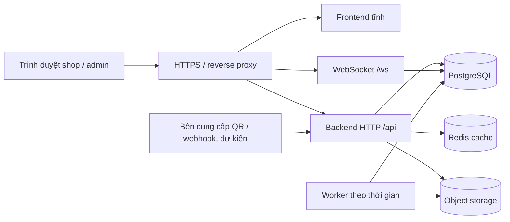

# Kiến trúc, hiệu suất và mở rộng

Trạng thái: thiết kế nền và hướng mở rộng, cập nhật 2026-11-18. Tài khoản và xét duyệt shop đã có code; các module khác trong tài liệu là thiết kế, chưa triển khai. Nghiệp vụ tham chiếu [SPEC.md](../SPEC.md).

Nơi chuẩn: topology/ranh giới module và chiến lược mở rộng. [Yêu cầu](2_requirements.md) giữ chính sách; [workflows](3_workflows.md) giữ state machine/transaction; [dữ liệu](7_data-model.md) giữ schema; [bảo mật](5_permissions-security.md) và [vận hành](10_operations.md) giữ kiểm soát/runbook.

## Hướng triển khai

Dùng **modular monolith cho nghiệp vụ** trong API Fastify, nhưng chia ba tiến trình: frontend tĩnh, backend HTTP và WebSocket. Backend và WebSocket dùng package phiên/DB chung. PostgreSQL vẫn là nguồn dữ liệu duy nhất. WebSocket hiện mới có kết nối đã xác thực, chưa có chat.



Vite proxy `/api` và `/ws` khi phát triển. Khi triển khai, reverse proxy cần phục vụ frontend build và chuyển hai đường dẫn này về backend/realtime trên cùng origin HTTPS, giữ `Host` và `Origin` của trình duyệt, và hỗ trợ WebSocket upgrade. Redis cache cục bộ đã có trong Compose; Redis production và reverse proxy production, object storage, worker **chưa có trong source**. Nhà cung cấp hạ tầng chưa chọn.

## Cấu trúc source

```text
apps/
  backend/src/
    server.js               # khởi động API
    app.js                  # ghép module, HTTP hook chung
    core/                   # hàm mật khẩu
    modules/
      identity/             # tài khoản, đăng nhập
      shops/                # hồ sơ và xét duyệt
      catalog/              # dự kiến: máy, tin đăng, giá nguồn
      conversations/        # dự kiến: chat và tệp đính kèm
      holds/                # dự kiến: giữ máy trực tiếp
      notifications/        # dự kiến: bảng thông báo
      subscriptions/        # dự kiến: gói tháng
      sourcing/             # dự kiến: xin nguồn (giai đoạn website)
      storefronts/          # dự kiến: website shop
      orders/               # dự kiến: đơn khách online
      wallet/               # dự kiến: số dư phí chợ, nạp QR và bút toán
  frontend/                 # Vite, giao diện đăng ký/đăng nhập/admin
  realtime/src/             # HTTP health và WebSocket /ws
packages/platform/          # pool DB, phiên dùng chung, Redis cache
db/migrations/              # schema thay đổi tuần tự
scripts/                    # migrate, tạo admin, công cụ vận hành
test/                       # kiểm tra HTTP, WebSocket + DB riêng
```

Một module thêm tính năng nên có `routes.js` (HTTP), `service.js` (quy tắc và transaction), `repository.js` (SQL) và `schema.js` (input/response) khi độ phức tạp cần. Không tạo file rỗng chỉ để đủ khung. `app.js` chỉ ghép module, không chứa SQL. Route không tự cập nhật bảng module khác; gọi service công khai của module đó. Module đặt theo nghiệp vụ, không theo trang giao diện. Backend sở hữu ghi dữ liệu; realtime phát sự kiện sau khi nghiệp vụ chat được xây.

## Dữ liệu và bất biến

| Module | Dữ liệu sở hữu dự kiến | Bất biến |
| --- | --- | --- |
| Identity | users, sessions | Token phiên lưu hash; xác thực trước route riêng |
| Shops | shops, shop_memberships, shop_reviews | Admin duyệt; đánh giá shop cũ chỉ tham khảo; CTV thuộc shop |
| Catalog | categories, product_groups, product_models, inventory_items, listings, media | Một tin là một máy; shop nguồn sở hữu giá và trạng thái; sold là trạng thái kết thúc, lưu mục Đã bán |
| Conversations | conversations, participants, messages, attachments | Chỉ shop tham gia được đọc; tệp tối đa 10 MB |
| Holds | holds | Một máy chỉ có một lượt giữ hiệu lực; thời hạn 12–72 giờ theo cấu hình A đặt riêng cho B, chụp lúc xác nhận cùng giá; không đổi hạn đang chạy hoặc sửa giá máy nguồn trong thời gian giữ |
| Notifications | notifications | Không gửi trùng cho cùng một sự kiện |
| Subscriptions | plans, subscriptions | Quyền sử dụng theo gói tháng, giá/gói chưa chốt |
| Wallet, dự kiến | lượt nạp, giao dịch ngân hàng, bút toán phí và số dư shop | Webhook xác thực/đối chiếu mới cộng tiền; định danh giao dịch duy nhất; số dư là nguồn quyết định ẩn/hiện vì nợ phí |
| Sourcing / Storefronts / Orders | quan hệ nguồn, bản treo, đơn và khóa online | Thuộc bản chính thức; không nhân bản tồn kho nguồn |

Bảng chưa có migration là **thiết kế**, không phải dữ liệu đã tồn tại. `users.role` và `shops.owner_user_id` hiện chỉ phục vụ một chủ shop. Trước khi thêm CTV hoặc nhiều tài khoản trong một shop, thêm `shop_memberships` và chuyển quyền sang quan hệ thành viên; không thêm nhiều cột `user_id` vào `shops`.

## Luồng qua module

1. Route kiểm tra input và xác thực, tạo `actor` gồm user, shop và vai trò.
2. Service kiểm tra quyền, bất biến; đổi nhiều bản ghi trong cùng transaction.
3. Repository chạy SQL có tham số, ràng buộc `shop_id` cho dữ liệu shop. Admin đi qua service riêng.
4. Thông báo, dọn tệp và tác vụ khác chạy sau commit. Khi có nhiều worker, dùng outbox PostgreSQL để tránh mất hoặc gửi trùng sự kiện.

Ví dụ giữ máy: trong transaction, khóa hàng máy, kiểm tra còn bán và chưa có lượt giữ hiệu lực, ghi giá nguồn vào hold, đổi trạng thái, commit, rồi thông báo. Trình duyệt không phải nơi ngăn hai reseller giữ cùng máy.

## Nhất quán và điểm dùng chung

Backend sở hữu mutation; realtime phát sau commit. Phiên trong DB; Redis chỉ cache-aside, không quyết định quyền/tồn kho/giữ. Catalog có danh mục/nhóm/mẫu ngay từ thiết kế; thuộc tính riêng của iPhone không áp cho mọi loại hàng. Dữ liệu schema và migration xem file dữ liệu.

Luồng cọc COD dự kiến: Orders tạo lượt chờ cọc/QR với mã riêng, bên cung cấp báo giao dịch vào tài khoản shop bán qua webhook HTTP, route xác thực webhook rồi service Orders đối chiếu và tạo đơn trong transaction PostgreSQL. Không cho route webhook tự ghi SQL hoặc WebSocket/Redis quyết định paid; provider/kết nối tài khoản của nhiều shop chưa chọn.

Luồng nạp số dư chợ dự kiến tách khỏi cọc COD: shop tạo lượt nạp/QR vào tài khoản nền tảng; webhook ngân hàng/bên kết nối đi qua route xác thực, service số dư đối chiếu và ghi bút toán/cộng số dư trong transaction PostgreSQL. Chỉ số dư đã ghi nhận mới gỡ lý do ẩn vì nợ phí khi đạt `0đ`; retry webhook không cộng lại. Module số dư và tích hợp ngân hàng chưa có code, nhà cung cấp chưa chọn; giữ route → service → repository khi triển khai.

Nạp thiếu mã/sai số tiền không tự cộng. Sau khi shop liên hệ riêng, admin kiểm tra tiền thực nhận và đúng shop rồi đi qua service số dư để cộng thủ công; cùng định danh giao dịch ngân hàng và ràng buộc duy nhất dùng cho cả webhook/admin. Lưu audit actor/lý do, không cho route admin ghi SQL trực tiếp hoặc tạo bút toán hai lần.

Worker dùng batch có giới hạn, thao tác idempotent và khóa DB; lưu outbox cùng transaction rồi giao sự kiện có retry/chống trùng. Khi tăng realtime phải có phát liên tiến trình và client resume. Media private ngoài source; không truyền tệp 10 MB qua socket. Chi tiết thuật toán ở workflows và hợp đồng ở API, không triển khai khóa trong RAM giữa các bản sao.

## Tải cần đo

- Mốc dự kiến hiện tại: khoảng **200 request/phút** (trung bình 3,3 request/giây). Mốc thử tăng trưởng: **200 request/giây**; không coi đây là năng lực đã đạt.
- Ghi riêng lượng request đọc/ghi, số shop cùng online, số kết nối WebSocket, tin nhắn/giây, số ảnh/tệp và dung lượng truyền. WebSocket đang mở không tương đương request/giây.
- Đo độ trễ p50/p95/p99, lỗi, CPU, bộ nhớ, event loop delay, `pool.totalCount/idleCount/waitingCount`, thời gian và số lần thực thi truy vấn. Đo trên dữ liệu đủ lớn và cấu hình giống triển khai thực tế; không suy ra năng lực từ bài test chức năng.
- Kiểm thử gồm tải đều 200 request/phút, tăng dần đến các mốc cao hơn, đợt ngắn 200 request/giây, và lúc một tiến trình ngừng. Ghi rõ cấu hình máy, tỷ lệ API, kích thước dữ liệu và tiêu chí đạt trước khi báo con số chịu tải.

## Tối ưu đã áp dụng

| Khu vực | Hiện có | Tác dụng và giới hạn |
| --- | --- | --- |
| Đăng ký shop | Hash mật khẩu trước khi lấy kết nối và mở transaction | Giảm thời gian giữ một client DB; không làm phép hash nhanh hơn |
| PostgreSQL | `PG_POOL_MAX` và `PG_CONNECT_TIMEOUT_MS` cho mỗi tiến trình | Giới hạn số kết nối và thời gian chờ pool; tổng kết nối là tổng của mọi bản sao và job |
| Admin xét duyệt | 25 shop/trang, cursor `(ưu tiên đang chờ, created_at, id)` và index cùng thứ tự | Không dùng offset tăng sâu; danh sách thay đổi giữa hai lần tải có thể làm vị trí bản ghi thay đổi |
| Redis cache | Cache-aside danh sách xét duyệt admin, TTL 15 giây; đổi phiên bản khóa sau đăng ký và xét duyệt | Chỉ admin đã xác thực được gọi; Redis lỗi thì đọc PostgreSQL; một request cũ có thể được phục vụ tối đa theo TTL khi việc vô hiệu hóa thất bại |
| WebSocket | Xác thực trên upgrade, giới hạn payload, ping/pong mỗi 30 giây | Dọn kết nối chết; chưa có luồng tin nhắn hay phát liên tiến trình |


## Thứ tự tăng tải

1. **Một bản sao mỗi ứng dụng:** đo các luồng thật, sửa truy vấn chậm, thêm index phù hợp, giới hạn response và thời gian chờ. Frontend tĩnh có thể được phục vụ ở edge.
2. **Nhiều backend:** sau reverse proxy, thêm bản sao API vì phiên đã ở DB. Kiểm soát tổng pool PostgreSQL; các mutation quan trọng vẫn dựa vào transaction/ràng buộc DB.
3. **Nhiều WebSocket:** cần phát sự kiện giữa các tiến trình và chiến lược reconnect/resume cho client trước khi bật bản sao thứ hai. Mỗi socket sống trên một tiến trình, còn tin nhắn sống trong DB.
4. **Database và job:** nếu đo được điểm nghẽn, tối ưu query/index và transaction trước; xem pooler, read replica cho đọc có thể chậm cập nhật, hoặc tách job. Không đọc trạng thái tồn kho/giữ hàng cần nhất quán từ replica trễ.

Redis đã được thiết lập cho cache cục bộ; chưa chọn Redis production, số máy, broker hay microservice vì chưa có số đo và chưa có module chat/tồn kho để đánh giá. Quyết định hạ tầng được ghi sau kiểm thử tải tương ứng.

## Trước khi triển khai thêm module

Chốt quyền, trạng thái, schema/API, điểm cache/invalidation và cách kiểm chứng; giữ route → service → repository. Thêm module theo nhu cầu thật, không tạo file rỗng để đủ khung. Bảo mật, migration an toàn, giám sát và thử restore là điều kiện vận hành, không phải khả năng đã nghiệm thu. Nhà cung cấp hạ tầng và SLO còn cần chốt tại [quyết định mở](12_open-decisions.md).
