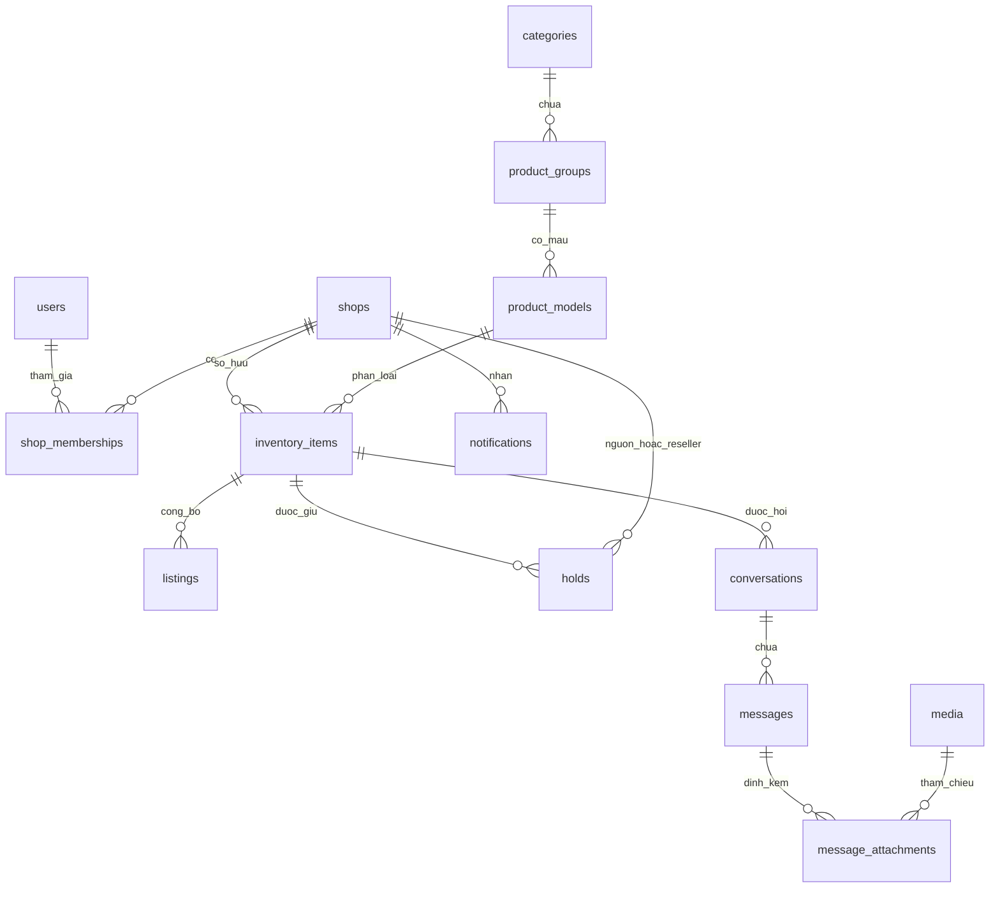

# Thiết kế dữ liệu và toàn vẹn

Trạng thái: đối chiếu migration hiện có ngày 2026-11-16; các bảng bổ sung là đề xuất, chưa phải schema để chạy. Ranh giới ghi theo [architecture](6_architecture.md), trạng thái theo [workflows](3_workflows.md).

## Schema thực tế

| Bảng | Cột và ràng buộc chính | Chủ sở hữu |
| --- | --- | --- |
| users | id UUID PK; email text UNIQUE NOT NULL; password_hash; role admin/shop_owner; created_at | identity |
| shops | id UUID PK; owner_user_id UNIQUE FK users; name, representative, phone, address, sales_channel; status pending/approved/rejected; review_note; reviewed_by FK users; reviewed_at; created_at | shops |
| sessions | token_hash text PK; user_id FK users ON DELETE CASCADE; expires_at; created_at | platform/session |
| schema_migrations | name PK, applied_at | script migrate |

Migration `001_identity.sql` tạo các bảng; `002_shop_admin_queue.sql` thêm index ưu tiên pending, created_at DESC, id DESC. Ngoài ra có index status/created_at trên shops và user_id trên sessions. Chưa có bảng máy, tin, hội thoại, giữ hàng hoặc thông báo.

Email được chuẩn hóa lowercase/trim trong service; DB hiện unique text không tự chuẩn hóa khi ghi ngoài service. Shop hiện có một owner, chưa có membership. Không viết quyền CTV dựa trên schema này.

## Quan hệ mục tiêu đề xuất

Cardinality không thay thế constraint: một conversation có đúng hai shop; mỗi hold có hai FK shop phân biệt; tối đa một hold confirmed chưa kết thúc trên một máy. Đây là thiết kế cần duyệt, không phải ERD của DB hiện tại.

## Bảng đề xuất theo module

| Bảng | Trường tối thiểu đề xuất | Ràng buộc / truy vấn cần hỗ trợ |
| --- | --- | --- |
| shop_memberships | shop_id, user_id, role, status, created_at, ended_at, ended_by | Unique shop/user; CTV chỉ một membership active; kết thúc bởi chủ shop sau khi hết giao dịch đã duyệt/hold/đơn mở; giữ lịch sử, migrate owner hiện có trước khi chuyển quyền |
| ctv_invitations | id, shop_id, invited_gmail_normalized, token_hash, status, sent_at, expires_at, accepted_at, accepted_by_user_id, cancelled_at, cancelled_by | Lời mời riêng theo Gmail, hạn 7 × 24 giờ từ lúc gửi; chủ shop có thể hủy invitation chưa accepted và vô hiệu token cũ ngay. Chấp nhận bằng tài khoản đúng Gmail đã xác thực, token một lần; chấp nhận và tạo membership active cùng transaction, một CTV không có hai shop active; hủy/chấp nhận cạnh tranh chỉ một kết quả |
| shop_applications | id, shop_id, submitted_by_user_id, shop_name, representative, phone, address, sales_channel, status, submitted_at, expires_at, decided_at, decided_by, decision_reason | Mỗi lần nộp có ID/snapshot riêng; pending chỉ hợp lệ trước `submitted_at + 30 × 24 giờ`, đúng mốc chuyển expired theo hiệu lực thời gian dù worker trễ. Chỉ một lần pending còn hiệu lực cho mỗi shop; rejected/expired nộp lại tạo bản ghi mới trên cùng shop, không ghi đè lịch sử |

| shop_reviews | id, application_id, target_shop_id, author_shop_id, author_user_id, basis, content, status, created_at, updated_at | FK `application_id` tới đúng lần nộp; một bản ghi cho mỗi (application_id, author_shop_id). Không tự đánh giá, author approved. Chỉ sửa/rút khi lần nộp còn pending và chưa hết hạn; giữ lịch sử thay đổi/người thao tác. Nhận xét cũ không chuyển sang lần nộp mới; không unique theo target_shop_id suốt đời |
| billing_plan_versions | id, plan_code, price_vnd, included_ctv, order_limit nullable, effective_at, changed_by, created_at | Cấu hình ban đầu: chợ 499.000đ/tháng, CTV trong gói, `order_limit=null`; website mẫu tùy chọn 200.000đ/tháng. Admin tạo phiên giá mới; kỳ shop đã trả giữ snapshot giá cũ, lần mua/gia hạn sau lấy phiên có hiệu lực. Phí resell FEE-02 không bị cộng gộp vào giá gói |
| platform_limit_versions | id, key, value, effective_at, changed_by, created_at | Giới hạn upload/sử dụng chỉ thêm khi trị số và phạm vi đã được duyệt; admin đổi qua dashboard với validation/audit. Giới hạn mới áp dụng cho thao tác mới, không làm media cũ mất hiệu lực. Không lưu khóa hoặc cấu hình kết nối R2 ở đây |
| categories | id, name, slug, active, sort_order, created_at | Danh mục dùng chung ngay từ đầu; slug unique; ban đầu chỉ Apple active |
| product_groups | id, category_id, name, slug, active | FK category; nhóm iPhone nằm trong Apple; unique category/slug |
| product_models | id, product_group_id, name, slug, active | FK nhóm; mẫu như iPhone 12, không phải máy thực tế. `active=false` chỉ ẩn khỏi lựa chọn khi tạo item mới, không làm mất hiệu lực item/tin cũ |
| inventory_items | id, source_shop_id, model_id, condition, accessories, warranty, source_price, private_imei, optional_serial, state, sold_at, sold_by, version, created_at, updated_at | Giá chính xác, không float; pin và trường nhập tin iPhone theo CAT-01. IMEI bắt buộc khi xuất bản iPhone nhưng nháp được thiếu IMEI; IMEI không unique: nhiều item, kể cả khác shop, có thể cùng IMEI. Serial tùy chọn. Không trả IMEI/serial cho reseller/CTV/khách. Mỗi item có ID riêng; chỉ một tin của cùng item nhận giao dịch tại một thời điểm; source_shop_id không đổi tùy ý |
| listings | id, item_id, status, published_at, expires_at, renewal_deadline, archived_at, archive_reason | Một item có thể có nhiều tin lịch sử qua các kỳ; tối đa một tin có hiệu lực/đang xử lý giao dịch tại một thời điểm. Tin quá cửa sổ gia hạn và hết giao dịch mở chuyển archived, giữ bản ghi; tin mới cho cùng item chưa sold phải kiểm tra/cập nhật tình trạng và ảnh |
| sale_events | id, item_id, source_shop_id, selling_shop_id, ctv_user_id nullable, order_id/hold_id nullable, sold_at, item_snapshot | Một sự kiện cho một lần bán thành công của item nguồn; shop đứng bán có thể khác shop nguồn. `ctv_user_id` ghi CTV trực tiếp bán nếu có, không tạo item/bản bán thứ hai. Giữ lịch sử bán của item cũ; sự kiện cung cấp Shop nguồn, Shop bán, CTV bán theo quyền xem. Máy khách trả đăng bán tiếp là item mới với sự kiện bán riêng |
| media | id, owner_shop_id, storage_key, original_name, detected_type, bytes, state, checksum, created_at | Cloudflare R2 là nơi lưu ban đầu; storage_key không public, ứng dụng tham chiếu qua media ID thay vì URL R2 cố định. Khi chuyển lớp lưu trữ/provider về sau cần metadata nơi lưu và migration kiểm tra checksum trước khi đổi nguồn đọc. Pending/ready/rejected; không dùng tên tệp làm đường dẫn |
| listing_media | listing_id, media_id, position | Media thuộc shop đăng; ảnh sẵn sàng trước xuất bản |
| conversations | id, item_id, source_shop_id, reseller_shop_id, item_snapshot, created_at | Hai shop khác nhau; chính sách unique/tái sử dụng chờ DEC-06 |
| messages | id, conversation_id, sender_user_id, sender_shop_id, client_request_id, type, body, created_at | Unique khóa retry theo conversation/sender/request; index conversation/created_at/id |
| message_attachments | message_id, media_id | Kiểm tra media đúng shop, hội thoại, trạng thái ready |
| holds | id, item_id, source_shop_id, reseller_shop_id, requested_by, status, confirmed_at, duration_hours, expires_at, source_price_snapshot, rejected_at, rejected_by, reject_reason nullable, cancelled_at, cancelled_by, cancel_reason nullable, completed_at, completed_by | Khi confirmed, `duration_hours` chụp từ quan hệ A–B (12–72, mặc định 12), `expires_at = confirmed_at + duration_hours`; không đổi theo cấu hình mới. FK; partial unique item khi status confirmed; nhiều requested cùng item được phép, nhưng xác nhận một requested tự chuyển requested khác của item sang rejected trong cùng transaction; kết thúc bản ghi quá hạn trước khi cấp mới |
| ctv_order_requests | id, shop_id, ctv_user_id, item_id, status, ctv_price_snapshot, proposed_amount, price_changed_at, reconfirm_expires_at, superseded_by_id, cancelled_at, cancel_reason, created_at, updated_at, version | Không có tên/số điện thoại/địa chỉ khách; request gồm máy và số tiền đề xuất. Giá đổi trước chủ shop duyệt thì chờ CTV xác nhận lại 12 giờ; chủ shop không duyệt request cũ. Gửi lại tạo request mới, liên kết lịch sử; hết hạn chỉ ẩn khỏi danh sách xử lý. Khi chủ shop ngừng hợp tác, request chưa duyệt chuyển cancelled với lý do hệ thống; không hard-delete |
| notifications | id, recipient_shop_id, event_id, type, payload, created_at, read_at | Unique recipient/event; index recipient/created_at/id; quyền đánh dấu đã đọc |
| outbox_events | id, aggregate_type, aggregate_id, type, schema_version, payload, created_at, attempts, next_attempt_at, delivered_at | Ghi cùng transaction; retry; consumer chống trùng theo event ID |
| audit_events | id, actor_user_id, actor_shop_id, action, target_type, target_id, request_id, created_at, safe_metadata | Không lưu secrets/raw body; quyền đọc giới hạn; retention cần chốt |

Mỗi kỳ gói shop cần lưu riêng thời điểm thanh toán được xác nhận, `starts_at`/`expires_at` và phiên giá áp dụng; không suy ra hạn gói từ `billing_plan_versions.effective_at` hoặc cộng cố định 30 ngày. Hạn là cùng giờ/ngày tháng kế tiếp tính từ chính lần xác nhận đó; tháng thiếu ngày dùng ngày cuối tháng. Chỉ nhận khoản gia hạn khi kỳ cũ đã hết hạn; kỳ mới bắt đầu từ lần xác nhận mới, không cộng kỳ vào hạn cũ. Lượt thanh toán gói qua QR vào tài khoản chợ cần gắn shop, loại gói, phiên giá/số tiền, mã tham chiếu và giao dịch ngân hàng duy nhất để webhook không kích hoạt hai kỳ. Đối soát thủ công khi sai/thiếu mã, sai số tiền hoặc webhook thất lạc cần lưu giao dịch thực nhận, shop, số tiền, admin, thời điểm và liên kết kỳ gói; một giao dịch chỉ kích hoạt tối đa một lần dù admin/webhook chạy cạnh tranh. Tách bút toán mua gói khỏi ví/số dư phí reseller và lượt nạp WAL-01; cách xử lý phần tiền dư còn cần chốt trước schema cuối.

Lưu kỳ trải nghiệm chợ 14 ngày với `starts_at` là lúc shop approved lần đầu và `expires_at = starts_at + 14 × 24 giờ`; tối đa một kỳ trải nghiệm/shop. Cùng transaction duyệt shop, ghi bút toán tặng 100.000đ vào số dư phí chợ với khóa duy nhất theo shop/loại thưởng; retry/duyệt lại không cộng lặp. Bút toán tặng không có hạn xóa số dư khi kỳ thử kết thúc; phí reseller dùng cùng số dư và ngưỡng `−100.000đ` như thường. Phiên cấu hình admin của mức tặng/bật tắt áp dụng tại thời điểm duyệt cần snapshot và audit; thay đổi cấu hình không sửa bút toán cũ.

Lưu hiệu lực gói chợ và gói website mẫu riêng theo `shop_id` và `plan_code`. Website hết hạn chỉ tạo lý do tạm ngừng cho website của đúng shop; không sửa trạng thái hàng nguồn, tin chợ, gói chợ/CTV hoặc đơn website đã mở. Lý do này được gỡ khi website được gia hạn hợp lệ, rồi tiếp tục xét tồn kho, hạn tin, giá và quyền gói chợ.

Trạng thái tạm khóa admin của shop approved cần tách khỏi trạng thái hồ sơ duyệt, kỳ gói và tồn kho từng máy; lưu từng khoảng khóa với người/thời điểm khóa và mở khóa cùng lịch sử audit. Với kỳ trải nghiệm 14 ngày và mỗi gói chợ/website mẫu đã trả còn hạn khi khóa, lưu mốc và `expires_at` trước khóa; trong lúc khóa, thời gian còn lại là `expires_at − locked_at`, không đếm tiếp bằng `now`. Mở khóa cộng đúng `unlocked_at − locked_at` vào hạn từng kỳ/gói trong transaction, một lần mỗi khoảng. Khóa lặp khi đang khóa hoặc mở lặp không tạo thời lượng bù mới; kỳ/gói hết hạn trước khóa không được bù. Kiểm tra cổng khóa tại transaction tạo việc mới cho shop nguồn hoặc shop bán; không sửa/xóa request, QR, hold hay đơn đã mở. Khi mở khóa chỉ gỡ lý do ẩn do khóa, không đổi các lý do ẩn khác hoặc cấp lại số dư tặng.

Lý do admin ẩn tin vi phạm cần là trạng thái/flag riêng gắn đúng listing/item nguồn, có admin/thời điểm và audit, không gộp với shop tự ẩn tin hoặc trạng thái sold. Từ tin nguồn tìm các bản treo reseller đang tham chiếu cùng item để vô hiệu giao dịch mới và tạo thông báo cho nguồn cùng từng reseller trong outbox; khóa sự kiện/recipient để retry không gửi trùng. Giao dịch mở giữ snapshot riêng, không xóa hoặc đổi giá vì tin bị ẩn. Lượt gửi xét duyệt lại gắn đúng listing, phiên bản tin đã sửa, người gửi, lúc gửi, trạng thái pending/approved/rejected và admin quyết định; tối đa một lượt pending hợp lệ cho mỗi tin. Shop sửa phiên bản mới trong lúc chờ thì lượt pending cũ mất hiệu lực, không cho admin duyệt nhầm. Admin chấp nhận mới gỡ cờ kiểm duyệt; visibility còn phụ thuộc gói, tồn kho, hạn tin, hợp tác và giá.

Kết thúc CTV phải kiểm tra trong cùng transaction: không còn request/đơn đã duyệt, request nguồn, hold hoặc đơn giao dịch mở gắn với CTV. Nếu còn thì không kết thúc hoặc hủy request pending trong thao tác bị từ chối. Khi đủ điều kiện, cập nhật membership ended, hủy mọi `ctv_order_requests` chưa duyệt của đúng CTV/shop, ghi sự kiện/thông báo sau commit. Đường tạo/gửi lại/duyệt request phải khóa/kiểm tra membership nhất quán để không lọt request mới sau lúc kết thúc; giữ ID và lịch sử giao dịch.

Không dùng biểu thức partial index dựa trên `now()` để mô tả hold còn hiệu lực. Unique trạng thái confirmed cùng transaction khóa máy và kết thúc hold cũ mới bảo vệ được cạnh tranh. Giá snapshot không sửa theo giá hiện tại.

Request bị tự từ chối vì nguồn chọn request khác cần lưu trạng thái/lý do hệ thống và thời điểm, giữ lịch sử shop yêu cầu. Hold hủy/hết hạn không phục hồi request cũ; request mới cần kiểm tra lại item và quan hệ nguồn. Tạo request và xác nhận request đều khóa máy trước rồi mới xử lý request theo ID để request mới không lọt vào sau lúc máy được giữ; cập nhật request thắng/thua cùng transaction để không có hai hold confirmed hoặc request cũ được duyệt sau khi máy đã bị giữ.

A chủ động từ chối riêng request còn requested: ghi rejected_at/rejected_by=A, lý do nếu có, không đổi request khác hoặc trạng thái máy, không ghi phí; thông báo shop gửi sau commit. Từ chối tự động vì A chọn request khác ghi nguyên nhân hệ thống riêng, không gán thành lý do thủ công của A. Reject/withdraw/confirm cùng request phải khóa item rồi request và kiểm tra lại status để chỉ một thao tác thắng.

Request B rút trước khi A xác nhận chuyển `requested → cancelled`, lưu cancelled_at và actor là chủ shop B; không ghi confirmed_at/expires_at, không khóa máy hoặc phát sinh phí. Đường rút và đường A xác nhận cùng khóa item/request, kiểm tra status trong transaction để chỉ một bên thắng; request cancelled không tái kích hoạt. Không suy quyền rút request của CTV từ việc CTV từng tạo request.

Hoàn tất hold trong hạn ghi completed_at/completed_by=A, item sold và bút toán phí B nhất quán trong một transaction; không có trường ảnh/chứng từ bắt buộc. Chủ shop B hủy hold confirmed còn hiệu lực trước khi A complete: ghi cancelled_at/cancelled_by, giữ lịch sử giá/hạn, không ghi completed_at hoặc khoản phí 50.000đ; A được báo sau commit. Hủy và complete cùng khóa item/hold theo một thứ tự để chỉ một trạng thái cuối thắng; expired/completed không thể hủy. Máy chỉ available nếu không sold/khóa đơn khác; bản tin hidden/expired không tự hiện. Request khác đã rejected không đổi lại requested.

Từ đúng expires_at, hold chuyển expired theo giờ DB dù worker chưa chạy; tin đủ điều kiện có thể hiện bán lại. Nếu A đã giao dịch ngoài website nhưng quên complete, nút Sản phẩm đã bán thông thường kiểm tra item chưa thuộc đơn/hold mới trong cùng transaction rồi chuyển item sold; hold cũ vẫn expired để giữ lịch sử chính xác, không gắn B hoặc tạo bút toán phí chợ B. Nếu khách đã tạo giao dịch mới, không ghi đè giao dịch đó; A tự xử lý với khách. Không cần schema hay trạng thái bán muộn riêng.

Ràng buộc CTV cần thêm: unique lời mời còn hiệu lực theo `(shop_id, invited_gmail_normalized)`; các shop khác được gửi tới cùng Gmail. Khi chấp nhận một lời mời, vô hiệu các lời mời còn hiệu lực của shop khác cùng Gmail trong transaction; membership cũ ended không được tái kích hoạt, quay lại phải có invitation mới. Request CTV lưu `owner_approval_expires_at = created_at + 24 giờ` cho lần tạo/gửi lại, snapshot giá/số tiền và trạng thái expired nếu quá hạn hoặc máy sold. Lịch sử sau rời shop phải có snapshot đủ để trả dữ liệu của chính CTV mà không đọc hàng/giá hiện hành hoặc danh tính nguồn. Giá CTV hàng resell kiểm tra sàn bằng giá nguồn ở server, không trả giá nguồn cho CTV.

Giá CTV cần lưu giá bán B và giá CTV cũ/mới hoặc version tương ứng để tính `CTV_mới = CTV_cũ + (B_mới − B_cũ)` nhất quán cho từng máy. Hàng resell chỉ áp dụng sau B treo lại với giá B mới, rồi kiểm tra sàn giá nguồn A. Không dùng giá nguồn A làm mốc chênh lệch giá CTV; không đổi snapshot của request/đơn đã duyệt.

COD resell thất bại cần lưu trạng thái bản treo B chờ B chọn treo lại sau khi A đưa máy chưa sold lên chợ, cùng notification và version để tránh bật lại tự động/race. Phí COD thất bại hoàn theo bút toán gốc một lần; đơn mới có khóa phí riêng theo quy tắc thường. Trạng thái này không phải return của đơn sold và không kế thừa chuỗi miễn phí trả hàng.

Đã chốt `expires_at = published_at + 90 × 24 giờ`, `renewal_deadline = expires_at + 3 × 24 giờ` theo giờ DB. Tin chỉ nhận giao dịch mới trước `expires_at`; chỉ gia hạn từ `expires_at` đến trước `renewal_deadline`. Tin expired chặn giao dịch mới theo thời điểm hiệu lực, không phụ thuộc worker. Sau `renewal_deadline`, quyền gia hạn hết; đợi giao dịch mở kết thúc rồi archive tin khỏi khu vực bán nhưng không xóa vật lý. Một item chưa sold được tạo tin mới sau khi kiểm tra/cập nhật tình trạng và ảnh, không tạo item thứ hai hoặc làm sống lại tin cũ. Unique/index bảo đảm tối đa một tin có hiệu lực/đang có giao dịch mở cho mỗi item, không unique toàn bộ lịch sử.

## Kiểu dữ liệu và thời gian

Đề xuất UUID cho ID; timestamptz cho thời điểm. VND lưu bigint số nguyên, API biểu diễn thống nhất trước code (đề xuất chuỗi số nguyên để tránh mất chính xác JavaScript). Số lượng và dung lượng tệp là số nguyên có giới hạn. Không dùng decimal dạng float cho tiền.

Snapshot lịch sử chứa mã item nội bộ, mẫu, tình trạng và giá cần đối chiếu; không sao chép IMEI/serial vào snapshot cho reseller/CTV/khách. Thiết kế nguồn snapshot phải ghi rõ thời điểm và version. Shop nguồn chỉ sửa tình trạng, phụ kiện, bảo hành, ảnh và IMEI nhập sai khi không có hold/đơn mở; mutation dùng khóa item và kiểm tra giao dịch trong cùng transaction. Thông tin quan trọng đổi thì version tăng, bản treo B tạm ẩn chờ treo lại, CTV không thấy máy. IMEI iPhone bắt buộc trước khi xuất bản, nháp có thể thiếu; có thể chuẩn hóa định dạng nhưng không có unique index/constraint trên IMEI ở inventory_items hoặc listings. Serial tùy chọn. Không dùng IMEI để suy ra item trùng; khóa giao dịch theo item ID. Hai item ID cùng IMEI vẫn là hai bản ghi tồn kho độc lập trong hệ thống, nên IMEI không tự ngăn một máy thực tế bị khai thành hai item. Ghi audit khi A sửa IMEI; không sửa lịch sử giao dịch đã bán.

Hàng resell cần phân biệt thời hạn bảo hành nguồn A công bố và thời hạn B cam kết với khách. Snapshot giao dịch giữ cả hai giá trị tại lúc giao dịch bắt đầu; B có thể tăng phần mình cam kết nhưng không sửa trường bảo hành nguồn trên item A. Lần B đổi cam kết về sau không sửa đơn đã mở hoặc đã bán. CTV và khách không cần thấy danh tính nguồn A từ dữ liệu bảo hành.

## Xóa và lưu trữ

- Tin expired quá cửa sổ được archive khỏi chợ sau khi giao dịch mở kết thúc, không hard-delete tự động; giữ bản ghi tin và snapshot giao dịch, không cascade conversation/messages/holds. Thời hạn lưu các dữ liệu khác và yêu cầu xóa dữ liệu cá nhân thuộc DEC-07.
- Không xóa người dùng/shop có lịch sử bằng cascade toàn miền. Chính sách vô hiệu hóa/ẩn danh và thời gian lưu cần DEC-07/10.
- Media còn được lịch sử tham chiếu không dọn như upload mồ côi. Job dọn kiểm tra reference lại trước khi xóa object.
- Phiên hết hạn không có quyền truy cập dù chưa được dọn khỏi bảng.
- Backup DB và object storage phải khôi phục được tham chiếu cùng thời điểm hoặc có quy trình xử lý object thiếu.

## Index và migration

Đề xuất index phục vụ danh sách máy shop/state/model; danh sách tin active/expiry; tìm kiếm theo bộ lọc thực; hold theo item/status và status/expires_at; hội thoại theo từng shop; messages theo conversation/created_at/id. Chỉ chốt index sau query và EXPLAIN trên dữ liệu đại diện; không thêm mọi tổ hợp bộ lọc.

Migration mới tăng số thứ tự, không sửa migration đã áp dụng. Review ràng buộc và dữ liệu cũ trước NOT NULL/UNIQUE. Với membership: backfill owner → kiểm tra đầy đủ → chuyển code quyền → chỉ bỏ owner cũ ở đợt sau nếu được duyệt. Với migration phá hủy dữ liệu, phải có backup và thử restore; rollback source không tự đảo schema.

## Thiết kế danh mục bắt buộc từ đầu

Yêu cầu nghiệp vụ tham chiếu CAT-00. Các bảng/cột bên dưới là thiết kế đề xuất, chưa phải migration đã có.

Đề xuất quan hệ: categories → product_groups → product_models → inventory_items. Dữ liệu khởi tạo: category Apple; nhóm iPhone; các mẫu iPhone theo danh mục được duyệt. Không seed sẵn Tivi/Bàn phím khi chưa mở kinh doanh. Apple trong taxonomy này là nhãn category theo yêu cầu; nếu bổ sung thương hiệu, dùng bảng brands riêng, không coi mọi category đều là thương hiệu.

Tách trường chung của đơn vị hàng (shop nguồn, mẫu, tình trạng chung, giá, trạng thái) khỏi thuộc tính theo nhóm. Đề xuất bảng item_iphone_details với item_id PK/FK, storage_gb, color, appearance, battery_percent, battery_unreadable, faults, replaced_parts, icloud_status; phụ kiện, bảo hành, giá và khu vực gắn item/tin theo snapshot giao dịch. Pin là số nguyên 0–100 hoặc trạng thái không đọc được, không đồng thời cả hai; bảo hành là số ngày nguyên không âm hoặc trạng thái chưa xác định, 0 là không bảo hành. Các ô mô tả phải có giá trị rõ khi xuất bản, gồm Không có/Không rõ khi phù hợp; nháp được thiếu. Service catalog kiểm tra đúng nhóm iPhone, đủ dữ liệu và ít nhất một ảnh thật trước xuất bản trong cùng transaction. Sau này Tivi/Bàn phím có bộ thuộc tính riêng, không phải điền pin/iCloud. Lựa chọn bảng chi tiết theo nhóm hay bộ thuộc tính cấu hình cần review trước migration, không thêm EAV tùy ý trong nhiệm vụ này.

Chỉ admin thêm/sửa/ngừng sử dụng category, nhóm và mẫu; shop thiếu mẫu tự nhắn admin, không có bảng/luồng yêu cầu bổ sung mẫu. Khi tạo item mới, server chỉ cho chọn category/nhóm/mẫu đang nhận hàng mới và nhất quán qua FK. Khi xuất bản/gia hạn/tạo kỳ tin tiếp theo cho item đã có, không chặn chỉ vì mẫu của item đã ngừng cho chọn: item/tin cũ vẫn bán theo điều kiện tồn kho, tin và giao dịch thông thường. Không xóa category/nhóm/mẫu đang được tham chiếu bằng cascade; ngừng nhận hàng mới không xóa lịch sử hoặc tự thay đổi hold. Việc thêm category không được đổi ý nghĩa ID máy/tin cũ hoặc buộc viết lại transaction tồn kho/giữ hàng.

## Bản treo trên website reseller — bản chính thức

Đề xuất storefront_products(id, reseller_shop_id, source_item_id, sourcing_permission_id, retail_price, accepted_source_price, accepted_source_version, status, updated_at). Unique reseller/source_item; FK tới hàng nguồn, không sao chép thành inventory_items mới. Giá nguồn thay đổi làm bản treo tạm ẩn; từng reseller tự treo lại theo giá mới và quyền còn hiệu lực. Hành động này không cập nhật listings.expires_at hoặc renewal_deadline của shop nguồn. Schema quyền xin nguồn/website cần thiết kế và duyệt trước triển khai bản chính thức.

## Lưu máy đã bán và chặn tái mở bán

Theo CAT-06, kho Đã bán dựa trên sale event và trạng thái sold của item cũ; không chuyển category/bảng làm mất ID hoặc FK lịch sử. Máy khách trả nếu được đăng bán tiếp thì tạo item/tin mới theo luồng thường; item/đơn cũ không bị sửa. IMEI là dữ liệu riêng tư bắt buộc của item iPhone nhưng không duy nhất và có thể trùng giữa item cũ và mới. Nút Sản phẩm đã bán thủ công có popup xác nhận ở UI; không thêm trạng thái hoặc sự kiện hoàn tác sold riêng chỉ để xử lý bấm nhầm.

Truy vấn Đã bán lấy item sold và sale event của item đó; shop được xem nếu là `inventory_items.source_shop_id` hoặc `sale_events.selling_shop_id`. CTV được xem cùng item sold nếu `sale_events.ctv_user_id` là chính mình và vẫn trong phạm vi quyền shop quản lý. Khi CTV của B bán máy nguồn A, A/B thấy cùng `item_id` và ba trường Shop nguồn A, Shop bán B, CTV bán; CTV đó thấy cùng `item_id`, Shop bán B và chính mình, nhưng response che `source_shop_id`/tên nguồn A và giá nguồn. Không nhân đôi item cho các bên xem; CTV khác không xem máy/đơn này. Khi không có CTV, `ctv_user_id` null và cột CTV bán trống. Máy khách trả được bán tiếp là item mới có sale event riêng, item sold cũ giữ lịch sử.

Thiết kế đề xuất: sold_at/sold_by ghi khi bán; CHECK yêu cầu đủ metadata cho sold. CHECK đơn hàng không kiểm tra được chuyển trạng thái cũ/mới, vì vậy dùng trigger DB BEFORE UPDATE để từ chối OLD.state=sold và NEW.state khác sold, cộng kiểm tra service. Ràng buộc/trigger khi tạo hoặc kích hoạt tin/hold/bản treo phải khóa và kiểm tra inventory item, tránh race với bán. Không chỉ bảo vệ ở UI. Trigger và migration chưa được viết.

Tin nguồn chuyển archived/archive_reason=sold và giữ lịch sử; không chịu job archive tin expired chưa sold sau cửa sổ gia hạn. Không cần bảng return, `reopened_by` hay định danh chuỗi bán/trả chỉ để đăng lại hàng khách trả. Item sold cũ giữ sale/order và phí gốc; shop sở hữu máy sau khi nhận về tạo item/tin mới qua luồng thường, với kỳ 90 × 24 giờ mới. Giao dịch resell của item mới có bút toán phí riêng theo FEE-02. Không cho sửa model/IMEI để biến item đã bán thành hàng khác; IMEI có thể trùng giữa item cũ và mới. Retention lịch sử vẫn cần chốt riêng; không đồng nghĩa lưu dữ liệu cá nhân vô hạn. Đề xuất index (source_shop_id, sold_at DESC, id DESC) cho mục Đã bán, kiểm tra query thực trước khi thêm.

## Bất biến giá khi có hold hiệu lực

Bất biến CAT-05 được thực thi qua kiểm tra transaction; thứ tự cạnh tranh nằm ở [workflows](3_workflows.md).

Đề xuất kiểm tra tại service và lớp bảo vệ DB khi cập nhật source_price: khóa hàng máy, kiểm tra hold confirmed còn hạn bằng giờ DB; chặn thay giá nếu còn giữ. Snapshot giá trong hold vẫn lưu để đối chiếu lịch sử. Trigger/guard phải phối hợp cùng thứ tự khóa với confirm/cancel/expire để tránh race; chi tiết cần kiểm thử trước migration. Không lưu duy nhất cờ price_locked có thể lệch với expires_at và không dùng Redis quyết định quyền sửa giá. Chưa có code cho kiểm soát này.

## Thiết kế đơn website và kết thúc hợp tác — đề xuất

- sourcing_relationships: source_shop_id/reseller_shop_id, status, hold_duration_hours (số nguyên 12–72, mặc định 12), ended_at; không có allowlist riêng sản phẩm/category. Chỉ chủ shop nguồn A đổi mức giữ của quan hệ với B; CTV thuộc B dùng cùng mức. Chỉ được kết thúc quan hệ khi không còn request/hold/đơn đang mở; kiểm tra có khóa cùng luồng tạo đơn. Đổi mức và xác nhận hold cạnh tranh phải tuần tự hóa trên cùng quan hệ; hold đã xác nhận giữ snapshot thời hạn cũ.
- orders/order_items tham chiếu source_item_id, quan hệ nguồn, shop bán, phương thức trả tiền và giá khách cần trả. Trả đủ tạo đơn và snapshot giá khi đặt; COD tạo lượt chờ cọc với cùng thông tin máy/giá, sau khi cọc được xác nhận trong hạn mới tạo đơn COD từ snapshot đó. Tách payment_status, purchase_status và fulfillment_status. Giá đã ghi không tự đổi khi giá niêm yết đổi, khóa máy chưa có nghĩa đã trả tiền hoặc máy sold. Thanh toán đủ được xác nhận là purchase_status=purchased/item=sold nhưng fulfillment có thể chưa giao. COD reseller đã chốt snapshot giá nguồn để tính cọc/đối soát; đơn trả đủ và giá khi shop xác nhận tiền muộn vẫn cần chốt chi tiết.
- Đơn trả đủ lưu `payment_deadline_at = created_at + 15 phút`; lượt chờ cọc COD riêng lưu `deposit_deadline_at = created_at + 15 phút`, tính theo giờ DB. Tại hoặc sau deadline mà khoản tương ứng chưa được xác nhận, quyền giữ máy hết ngay, không phụ thuộc worker. Cọc COD xác nhận trước hạn tạo đơn COD và chuyển khóa máy từ lượt chờ sang đơn một cách nguyên tử; đơn này không bị hết hạn giao hàng theo mốc chờ cọc. Ghi nhận tiền trả đủ đến muộn tách khỏi Đã mua; khách/shop trao đổi riêng về giá và cách xử lý, không có giá tự chọn bởi hệ thống. Shop bán chỉ xác nhận sau đối chiếu, thỏa thuận và khóa lại máy còn available. Nếu máy đã thuộc giao dịch khác, không đổi sold/hold/đơn mới; shop nhận tiền tự hoàn cho khách ngoài website, không tạo bảng hoặc trạng thái hoàn tiền cho ngoại lệ này. Cọc COD đến muộn không tạo đơn từ lượt chờ đã hết hạn hoặc lấy lại quyền giữ máy; không mô hình hóa hoàn tiền trả đủ đến muộn.
- Lượt chờ cọc cần mã thanh toán duy nhất, shop/tài khoản nhận, số tiền cọc và định danh giao dịch phía bên cung cấp; không lưu QR như bằng chứng tiền đã nhận. Webhook được xác thực, đối chiếu và ghi sự kiện giao dịch với ràng buộc duy nhất để retry không tạo hai đơn/trừ hai phí. Không lưu secret webhook/raw dữ liệu nhạy cảm trong log. Khi webhook tới sau khi lượt chờ hết hạn, kể cả `transaction_time < deposit_deadline_at`, lưu vết tiền đến để đối chiếu nhưng không tạo đơn, giữ máy hoặc khoản trừ phí chợ; khách/shop xử lý cọc ngoài website.
- Khóa online riêng với holds; item trong chờ giao, vận chuyển hoặc chờ hoàn không available và không sold trước thành công COD. Đề xuất thêm trạng thái reserved_for_order vào inventory_items; schema cụ thể cần review.
- Ghi dispatched_at, delivery_result, actor nguồn xác nhận thất bại và thời điểm; nút Giao không thành công đóng đơn và giải phóng máy chưa sold trong cùng transaction, giữ ID/lịch sử. Không đặt sold rồi đảo sold về available. Không tạo trường/bằng chứng nhận hoàn làm điều kiện hệ thống để nhấn nút; A chịu trách nhiệm xác nhận, còn cập nhật tình trạng thực tế của máy khi thay đổi theo quy tắc sửa tin.
- Với đơn reseller bán máy nguồn: đơn trả đủ cần biểu diễn bên giao A hoặc B theo thỏa thuận từng đơn. COD có bên gửi/nhận tiền thu hộ là A; cọc vào B. Mỗi shop cần trường cấu hình mức cọc COD, nhưng đơn trên web B dùng mức B và snapshot giá máy P, giá nguồn S, cọc D áp dụng. Ràng buộc `0 < D <= min(D_config_B, 10% × P)` và `D < P − S` khi tạo lượt chờ cọc; không trừ phí chợ 50.000đ khỏi `P − S` để kiểm tra giới hạn; nếu không đạt thì không có COD cho máy resell đó. `P = S` không có COD trên web B. Máy shop tự sở hữu không áp ràng buộc phần lời. Số COD cho giá máy là `P − D`; không mô hình hóa phí vận chuyển/hoàn COD giữa A và hãng trong dữ liệu website. Khi thành công, `P − S − D > 0` là phần A còn chuyển B; phép tính không đồng nghĩa đã chuyển tiền. Giá/cọc cấu hình đổi sau không sửa snapshot đơn. A chuyển B ngoài website; lưu trạng thái đối soát chờ A chuyển → A đã xác nhận chuyển, cùng actor/thời điểm. B không có bước xác nhận, thao tác A không chứng minh giao dịch ngân hàng. Không lưu deadline đối soát hoặc tự chuyển trạng thái do quá hạn; trạng thái chờ A xác nhận tiếp tục cho tới khi A bấm “Đã chuyển”. Không lưu ảnh biên lai cho thao tác này. Lưu trạng thái cọc tách phần COD; website chỉ lưu vết trạng thái giao thất bại, không ghi nghĩa vụ hoàn/giữ cọc thay A/B. Đề xuất lưu bên giao/actor bàn giao/thời điểm để phân quyền, audit.
- Phí chợ 50.000đ chỉ gắn reseller B bán máy nguồn A; shop tự bán máy sở hữu không chịu phí. Gắn khoản phí với giao dịch/máy nguồn và B, ràng buộc duy nhất để không trừ hai lần: đơn trả đủ web khi xác nhận thanh toán/Đã mua; COD web khi cọc hợp lệ tạo đơn; request/giữ theo thời hạn đã chốt của B hoặc CTV thuộc B khi A xác nhận chốt thành công trong hạn. Request, lượt giữ chưa hoàn tất và lượt chờ cọc chưa thành đơn không có khoản trừ. `−100.000đ` là ngưỡng tạm ẩn sản phẩm resell/chặn đơn web mới, không là sàn cứng cho số dư: Đơn trả đủ đã tạo, QR COD đã phát và request lấy máy reseller/CTV đã gửi trước lúc chạm ngưỡng vẫn được xử lý khi thanh toán/cọc hoặc duyệt/chốt giữ hợp lệ trong hạn, ghi phí và số dư thực dù thấp hơn ngưỡng (ví dụ `−150.000đ`). Ngưỡng chặn đơn web mới có hiệu lực ngay; giao dịch cũ kết thúc không xóa lý do ẩn vì nợ phí khi số dư còn âm. Lưu thời điểm/trạng thái phát QR và vết thay đổi ngưỡng để phân biệt lượt đã mở với lượt mới; chi tiết schema cần review. Biểu diễn phí/số dư riêng, tách cọc khách, COD của A và đối soát A-B. COD web reseller giao thất bại cộng lại đúng khoản đã trừ cho B, tham chiếu khoản trừ gốc để không hoàn lặp; không tạo tiền nếu chưa từng trừ. Khi số dư chạm ngưỡng, sản phẩm resell tạm ẩn với lý do phí chợ nhưng giữ đơn/lịch sử đang mở. Khi số dư được cập nhật/đối chiếu tới `0đ` hoặc dương, bỏ lý do ẩn do nợ phí; số dư còn âm vẫn giữ lý do này. Visibility thực tế vẫn phụ thuộc các điều kiện khác của tin/máy/quan hệ nguồn; không biến tin sold/hết hạn/ẩn vì lý do khác thành đang bán. Chi tiết đối soát số dư và chi tiết tích hợp nạp chưa chốt. Chưa mô hình hóa cơ chế tương lai trừ số dư tương ứng tiền khách cọc.
- Lưu thời điểm request reseller/CTV lấy máy được tạo và shop sở hữu request. Ngưỡng phí được kiểm tra khi tạo request mới; request đã tạo trước ngưỡng có thể chuyển sang confirmed sau ngưỡng và hoàn tất hold theo thời hạn đã chốt, không bị thu hồi chỉ vì số dư thay đổi. Bút toán phí gắn với hold completed, không gắn request/confirmed, để retry/đồng thời không trừ hai lần. Kiểm tra thời điểm/trạng thái trong transaction cùng khóa số dư và giao dịch; schema chi tiết cần review.
- WAL-01: dự kiến lưu lượt nạp gồm shop, mã tham chiếu duy nhất, số tiền yêu cầu, tài khoản nhận của nền tảng, trạng thái và thời điểm; sự kiện ngân hàng/bên kết nối gồm định danh giao dịch duy nhất, số tiền thực nhận và kết quả đối chiếu. Webhook đã xác thực/khớp mới tự động ghi một bút toán cộng số dư gắn lượt nạp và giao dịch ngân hàng, trong cùng transaction với cập nhật số dư; retry không ghi lại. QR và lượt nạp pending không làm tăng số dư. Khi số dư đạt từ `0đ`, gỡ lý do ẩn vì nợ phí trong cùng ranh giới nhất quán, không sửa các lý do ẩn khác. Giao dịch không khớp được lưu vết để đối soát nhưng không tự cộng. Schema chi tiết, ngân hàng/bên kết nối và ngoại lệ webhook thiếu còn mở; không lưu secret webhook hoặc dữ liệu nhạy cảm thô trong log.
- Giao dịch nạp thiếu mã/sai số tiền được admin đối soát thủ công sau khi shop liên hệ riêng. Bút toán cộng thủ công tham chiếu định danh giao dịch ngân hàng thực nhận và lưu admin, shop nhận tiền, số tiền, lý do, thời điểm; ràng buộc duy nhất trên giao dịch gốc dùng chung với webhook để hai đường không cộng lặp. Cập nhật bút toán, số dư và lý do ẩn vì nợ phí trong cùng ranh giới nhất quán. Tin nhắn/ảnh của shop không thay bằng chứng tiền thực nhận; không mặc định xây bảng hội thoại riêng cho ngoại lệ này.
- Kiểm tra thanh toán/cọc lặp và callback/retry idempotent, khóa hàng nguồn để thanh toán web/lượt chờ cọc COD/confirm giữ cạnh tranh không chiếm cùng máy. Chưa chọn tích hợp thanh toán; đơn trả đủ có hạn trả tiền 15 phút, lượt chờ cọc COD có hạn 15 phút riêng, không áp hạn này cho đơn COD đã tạo hoặc hold trực tiếp.

## Tài khoản nhiều cách đăng nhập — thiết kế cần bổ sung

ACC-01..04/SHOP-06 yêu cầu user tồn tại trước shop và có Google, mật khẩu hoặc cả hai cùng một user_id. Schema hiện tại chưa biểu diễn đủ Google-only/liên kết provider; không tạo password giả hoặc user/shop bản sao. Cần thiết kế ràng buộc identity provider, mapping duy nhất và password credential tùy phương thức; migration cụ thể chưa duyệt. Nhập lại mật khẩu chỉ để kiểm tra đầu vào, không lưu cột xác nhận mật khẩu. Giữ lịch sử và quan hệ shop khi thêm phương thức đăng nhập. Gmail/mật khẩu cần trạng thái chưa xác minh và mốc verified/activated; token/link xác minh là dữ liệu riêng có vòng đời, không lưu token thô trong log. Link hết hạn sau 10 phút từ lúc gửi; thiết kế có sent_at/expires_at tương ứng và kiểm tra giờ server. Mỗi tài khoản chỉ một link xác minh hiện hành; phát hành link mới và thay thế link cũ phải nhất quán khi gửi lại/xác minh cạnh tranh. Lần gửi mới phải cách lần trước ít nhất 60 giây cho cùng tài khoản, kiểm tra nhất quán ở server kể cả nhiều tab/tiến trình. Giữ mốc/lịch sử gửi để kiểm tra tối đa 5 email/tài khoản trong 60 phút (kể cả lần đầu), không chỉ một cờ hoặc bộ đếm UI. Kiểm tra quota/cooldown phải nhất quán khi có request cạnh tranh. Schema cụ thể và tính quota khi mail lỗi còn cần duyệt.

ACC-05 bổ sung credential recovery cho user đã có password và Gmail verified; không tạo identity/shop mới. Đề xuất tách mục đích reset khỏi token xác minh email, dùng hash token/trạng thái/thời điểm và cập nhật credential trong transaction. Reset có hạn 10 phút, cách gửi 60 giây, tối đa 5 email/tài khoản/60 phút tính riêng xác minh đăng ký; lưu/kiểm tra mốc gửi và quota theo tài khoản + mục đích. Link reset mới thay thế link reset cũ, không thay link verify; kiểm soát cạnh tranh giống các mutation identity. Đặt lại thành công phải tiêu thụ token một lần và thu hồi tất cả phiên ứng dụng của user trong cùng ranh giới nhất quán với cập nhật password; chặn hai request reset đồng thời cùng link đều thành công. Không xóa liên kết Google hoặc tác động phiên tài khoản Google bên ngoài ứng dụng. Chi tiết schema/transaction cần review trước code.
